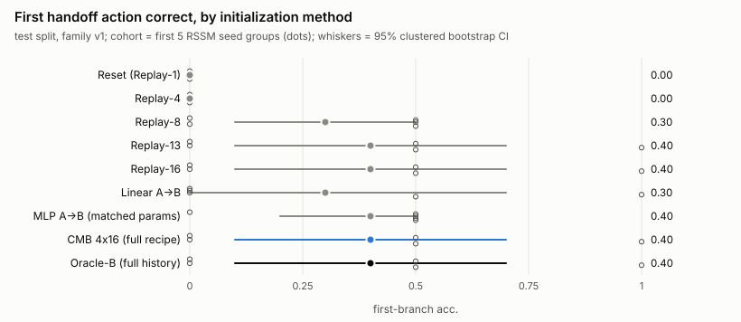
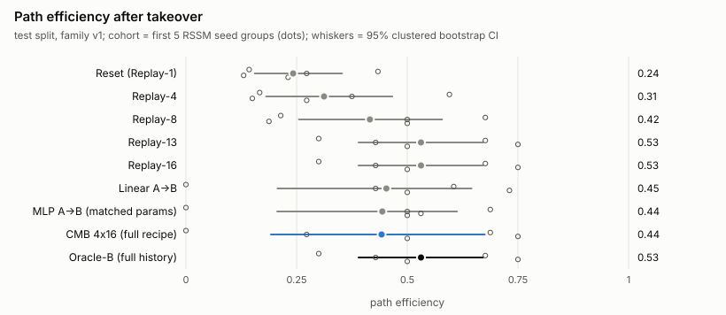
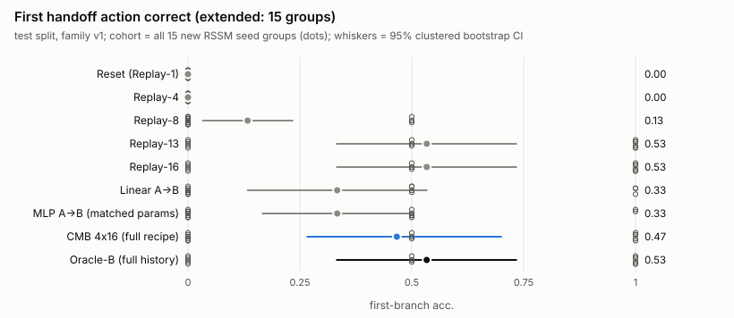
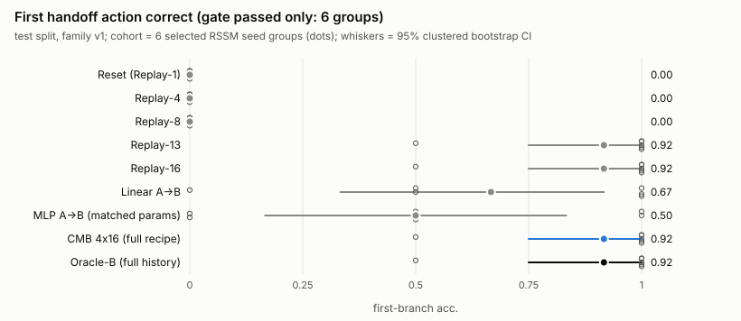
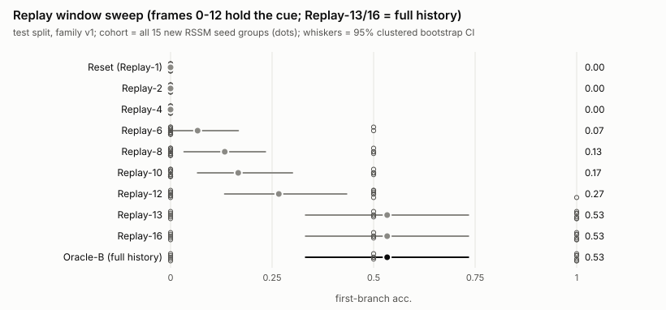
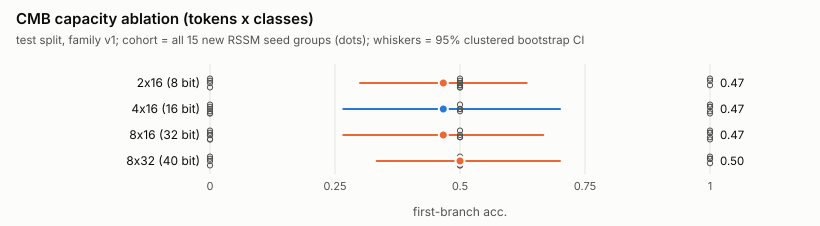
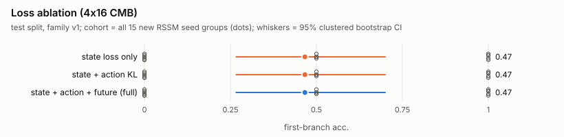
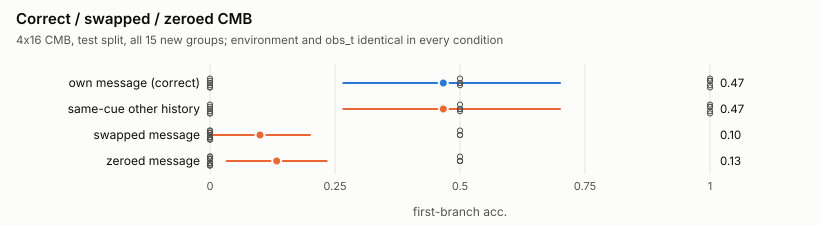

# CMB MiniGrid experiment report (Step 10 pilot)

All numbers below are computed from the artifacts in `runs/step10` by `cmb_minigrid.scripts.make_report`; nothing is simulated.
**Scope: pilot-scale.** 5 pre-planned independent RSSM training-seed groups (g1, g2, g3, g4, g5; A seed 1000+g, B seed 2000+g), one bridge-training seed (42) per group, one task (HiddenHistoryNav, handoff at t=12, one-bit early cue), held-out test family v1 (10 counterfactual pairs per group). Group `g0` is the pre-existing Step 5-9 checkpoint set and is shown separately. 

## 0. Findings and how far they go

*Written by hand after reading the tables below; every number is copied from them.
CIs are 95% clustered-bootstrap intervals (RSSM seed group > pair). Dozens of paired
comparisons were computed with no multiplicity correction, so isolated "CI excludes 0"
cases are exploratory.*

**Study-design note (post-hoc).** The pre-planned cohort was 5 RSSM seed groups (g1-g5).
Only 1 of them (g4) passed both operational gates, so the cohort was extended to 15 groups
(g6-g15) to estimate the pass rate. The extension was decided after seeing the first
results; all three cohorts (first 5, all 15, gate-passed 6) are reported and none was
dropped. The "gate-passed" cohort is selected on Oracle-B's own performance and is a
sensitivity analysis, not a headline.

**1. The RSSM/Actor-B pipeline itself is not seed-robust.** Over 15 new seed groups the
frozen-probe gate passes 6/15, the Oracle-vs-Reset actor gate 10/15, both 6/15; Oracle-B
reaches first-branch accuracy 1.0 in only 6/15 groups (g4, g8, g9, g10, g14, g15), and in
5 groups (g1, g3, g6, g7, g13) it is 0.0. A bridge distilled from Oracle-B cannot do better
than its teacher, so group-level results are dominated by whether the two world models and
Actor-B work at all. This is a finding about the Step 5/6 recipes, not about the bridge.

**2. Where a working Oracle exists, the CMB reproduces its first handoff decision.**
CMB first-branch accuracy equals Oracle-B's in 14 of 15 new groups plus g0; the exception is
g9, where RSSM-A fails its own cue probe (val 0.5), i.e. A has nothing to send.
- First 5 groups (all outcomes): CMB 0.40 [0.10, 0.70] vs Reset 0.00; CMB - Reset = +0.40
  [+0.10, +0.70]. CMB - Replay-8 = +0.10 [-0.30, +0.60], CMB - MLP = +0.00 [-0.30, +0.30],
  CMB - Linear = +0.10 [0.00, +0.30]: **not distinguishable from Replay-8, MLP or Linear in
  this cohort.**
- All 15 groups: CMB 0.47 [0.27, 0.70], Oracle 0.53 [0.33, 0.73], Replay-13 0.53, Linear
  0.33 [0.13, 0.53], MLP 0.33 [0.17, 0.50], Replay-8 0.13 [0.03, 0.23], Reset 0.00.
- Gate-passed 6 groups (sensitivity): CMB 0.92 [0.75, 1.00] = Oracle = Replay-13;
  Linear 0.67 [0.33, 0.92]; MLP 0.50 [0.17, 0.83]; Replay-8 0.00. CMB - Linear = +0.25
  [+0.08, +0.42] and CMB - MLP = +0.42 [+0.17, +0.67] exclude 0 there.

**3. The CMB did not exceed full replay or Oracle-B in any cohort.** CMB - Oracle and
CMB - Replay-13 are 0.00 [0.00, 0.00] on first-branch accuracy and -0.09 [-0.21, +0.00] on
path efficiency (first 5). Replay with a window that reaches `obs[0]` (13 frames, 1,936
bytes) matches the CMB (2 bytes) when A's state holds the cue; the CMB's demonstrated
advantage over it is payload size only, at the cost of training a bridge, and Replay needs
no A model. Replay windows of 4 or 8 frames (595 / 1,191 bytes) never contain the cue: Replay-4 stays at
0.00 in every cohort and Replay-8 is 0.00 in the gate-passed cohort; its 0.30 / 0.13 in the
first-5 / all-15 cohorts comes from groups (e.g. g2, g3, g5) whose Actor-B emits the same
branch for both cues (Oracle-B is also 0.5 there), not from recovered memory. Replay-12
(which includes `obs[1]`) is already partial (0.33 in gate-passed groups).
Linear and MLP A->B did **not** beat the CMB on first-branch accuracy
in the gate-passed cohort, but their closed-loop *success* (0.83) is higher than CMB/Oracle
(0.75): success also counts recoveries from the visible wrong-branch dead end, which is why
success is not used as the memory measure.

**4. Ablations show little that is detectable at this sample size.**
- Capacity 2x16 / 4x16 / 8x16 / 8x32: first-branch 0.47 / 0.47 / 0.47 / 0.50 over all 15
  groups, paired differences vs 4x16 within about +/-0.13; in the gate-passed cohort 2x16 is
  -0.17 [-0.33, 0.00] and 8x32 -0.08 [-0.25, 0.00] (CIs touch 0). No capacity benefit beyond
  8 bits is demonstrated for a one-bit cue.
- Loss: first-branch accuracy is the same for state-only, state+action and full recipes.
  Path efficiency differences are small and inconsistent (state+action vs full: -0.07
  [-0.16, -0.00] over all 15; state-only vs full: -0.04 [-0.08, -0.01] gate-passed); I do
  not claim the Action or Future loss helps.
- Message condition (4x16): own message 0.47 [0.27, 0.70]; same cue from another history
  0.47 (no change); swapped 0.10 [0.00, 0.20]; zeroed 0.13 [0.03, 0.23] over all 15; in
  the gate-passed cohort own 0.92 vs swapped 0.00 and zeroed 0.00. The decision follows the
  message when environment and `obs_t` are fixed.
- **History-gap ablation {8,16,32,64} was not run** (see Section 6).

**5. Evidence boundaries.**
- *Single cue transmitted* — **supported** for groups whose RSSM-A carries the cue: swap /
  zero collapse the decision, same-cue messages do not, and the CMB matches Oracle-B. Still a
  one-bit cue at one fixed handoff time.
- *Sustained closed-loop recovery* — **not established.** Even Oracle-B reaches only success
  0.75 and path efficiency 0.53 in the gate-passed groups (12 wrong actions per episode on
  average), because Actor-B itself errs after the branch. The CMB equals Oracle-B within the
  CI, so the ceiling is the Actor, not the bridge; this experiment cannot show sustained
  prediction recovery.
- *Truly shared cross-model space* — **not tested.** One direction (A to B), same data and
  recipe, one bridge per pair, no third model or unseen pair.

## 1. Gates per group

| group | probe full-history val acc A / B | Oracle first-branch (test) | Reset first-branch (test) | gap | probe gate | actor gate |
| --- | --- | --- | --- | --- | --- | --- |
| g0 | 1.00 / 1.00 | 1.00 | 0.00 | 1.00 | pass | pass |
| g1 | 0.50 / 0.50 | 0.00 | 0.00 | 0.00 | FAIL | FAIL |
| g2 | 0.50 / 0.50 | 0.50 | 0.00 | 0.50 | FAIL | pass |
| g3 | 1.00 / 0.50 | 0.00 | 0.00 | 0.00 | FAIL | FAIL |
| g4 | 1.00 / 1.00 | 1.00 | 0.00 | 1.00 | pass | pass |
| g5 | 1.00 / 0.50 | 0.50 | 0.00 | 0.50 | FAIL | pass |
| g6 | 0.50 / 0.50 | 0.00 | 0.00 | 0.00 | FAIL | FAIL |
| g7 | 0.50 / 0.50 | 0.00 | 0.00 | 0.00 | FAIL | FAIL |
| g8 | 1.00 / 1.00 | 1.00 | 0.00 | 1.00 | pass | pass |
| g9 | 0.50 / 1.00 | 1.00 | 0.00 | 1.00 | FAIL | pass |
| g10 | 1.00 / 1.00 | 1.00 | 0.00 | 1.00 | pass | pass |
| g11 | 1.00 / 0.50 | 0.50 | 0.00 | 0.50 | FAIL | pass |
| g12 | 1.00 / 1.00 | 0.50 | 0.00 | 0.50 | pass | pass |
| g13 | 0.50 / 0.50 | 0.00 | 0.00 | 0.00 | FAIL | FAIL |
| g14 | 1.00 / 1.00 | 1.00 | 0.00 | 1.00 | pass | pass |
| g15 | 1.00 / 1.00 | 1.00 | 0.00 | 1.00 | pass | pass |

Operational gate definitions (mine, not from the spec): probe gate = frozen linear-probe val accuracy >= 0.9 on the full-history state for both A and B; actor gate = Oracle-B minus Reset-B first-branch accuracy >= 0.5 on test. Groups passing both: g4, g8, g10, g12, g14, g15. **All groups are included in the headline statistics regardless of gate status**; `gate_passed_only` is a labeled sensitivity analysis in `tables/*_gate_passed_only_*.csv`.

Gate pass rates over the 15 new groups: probe gate 6/15, actor gate 10/15, both 6/15. The Step 5/6 training recipes are therefore **not seed-robust** in this repository: Oracle-B reaches first-branch accuracy 1.0 in only 6/15 groups, which caps what any bridge distilled from it can reach.

## 2. Main comparison (test split, clustered bootstrap 95% CI)

Headline cohort: pre-planned groups g1, g2, g3, g4, g5 (all gate outcomes included).

| Method | first-branch acc. | success | path efficiency | wrong actions |
| --- | --- | --- | --- | --- |
| Reset (Replay-1) | 0.00 [0.00, 0.00] | 0.60 [0.50, 0.80] | 0.24 [0.16, 0.35] | 26.00 [19.80, 30.00] |
| Replay-4 | 0.00 [0.00, 0.00] | 0.60 [0.50, 0.80] | 0.31 [0.18, 0.47] | 22.90 [13.30, 28.60] |
| Replay-8 | 0.30 [0.10, 0.50] | 0.60 [0.50, 0.80] | 0.42 [0.26, 0.58] | 21.10 [11.90, 26.60] |
| Replay-13 | 0.40 [0.10, 0.70] | 0.70 [0.50, 0.90] | 0.53 [0.39, 0.67] | 14.00 [5.10, 22.90] |
| Replay-16 | 0.40 [0.10, 0.70] | 0.70 [0.50, 0.90] | 0.53 [0.39, 0.67] | 14.00 [5.10, 22.90] |
| Linear A->B | 0.30 [0.00, 0.70] | 0.60 [0.30, 0.90] | 0.45 [0.21, 0.65] | 18.00 [7.40, 28.40] |
| MLP A->B (matched params) | 0.40 [0.20, 0.50] | 0.60 [0.30, 0.90] | 0.44 [0.21, 0.61] | 17.60 [7.50, 27.60] |
| CMB 4x16 (full recipe) | 0.40 [0.10, 0.70] | 0.60 [0.30, 0.90] | 0.44 [0.19, 0.68] | 17.00 [6.90, 27.10] |
| Oracle-B (full history) | 0.40 [0.10, 0.70] | 0.70 [0.50, 0.90] | 0.53 [0.39, 0.67] | 14.00 [5.10, 22.90] |

### Paired differences (same pairs, same groups)

| A - B | metric | difference [95% CI] | CI excludes 0 |
| --- | --- | --- | --- |
| CMB 4x16 (full recipe) - Reset (Replay-1) | first-branch acc. | +0.40 [+0.10, +0.70] | yes |
| CMB 4x16 (full recipe) - Reset (Replay-1) | path efficiency | +0.20 [-0.03, +0.43] | no |
| CMB 4x16 (full recipe) - Replay-8 | first-branch acc. | +0.10 [-0.30, +0.60] | no |
| CMB 4x16 (full recipe) - Replay-8 | path efficiency | +0.03 [-0.18, +0.30] | no |
| CMB 4x16 (full recipe) - Replay-13 | first-branch acc. | +0.00 [+0.00, +0.00] | no |
| CMB 4x16 (full recipe) - Replay-13 | path efficiency | -0.09 [-0.21, +0.00] | no |
| CMB 4x16 (full recipe) - Linear A->B | first-branch acc. | +0.10 [+0.00, +0.30] | no |
| CMB 4x16 (full recipe) - Linear A->B | path efficiency | -0.01 [-0.09, +0.05] | no |
| CMB 4x16 (full recipe) - MLP A->B (matched params) | first-branch acc. | +0.00 [-0.30, +0.30] | no |
| CMB 4x16 (full recipe) - MLP A->B (matched params) | path efficiency | -0.00 [-0.14, +0.13] | no |
| CMB 4x16 (full recipe) - Oracle-B (full history) | first-branch acc. | +0.00 [+0.00, +0.00] | no |
| CMB 4x16 (full recipe) - Oracle-B (full history) | path efficiency | -0.09 [-0.21, +0.00] | no |
| CMB 2x16 - CMB 4x16 (full recipe) | first-branch acc. | +0.00 [-0.30, +0.30] | no |
| CMB 2x16 - CMB 4x16 (full recipe) | path efficiency | +0.03 [-0.04, +0.14] | no |
| CMB 8x16 - CMB 4x16 (full recipe) | first-branch acc. | +0.10 [+0.00, +0.30] | no |
| CMB 8x16 - CMB 4x16 (full recipe) | path efficiency | +0.05 [+0.00, +0.14] | no |
| CMB 8x32 - CMB 4x16 (full recipe) | first-branch acc. | +0.00 [-0.30, +0.30] | no |
| CMB 8x32 - CMB 4x16 (full recipe) | path efficiency | +0.03 [-0.04, +0.14] | no |
| CMB state_only - CMB 4x16 (full recipe) | first-branch acc. | -0.10 [-0.30, +0.00] | no |
| CMB state_only - CMB 4x16 (full recipe) | path efficiency | -0.02 [-0.07, +0.03] | no |
| CMB state_action - CMB 4x16 (full recipe) | first-branch acc. | +0.00 [+0.00, +0.00] | no |
| CMB state_action - CMB 4x16 (full recipe) | path efficiency | -0.11 [-0.32, +0.00] | no |

### Extended cohort and gate-passed sensitivity

The cohort was extended from 5 to 15 groups **after** seeing that only part of the first 5 passed the gates, to estimate the pass rate; this is a post-hoc decision. Both cohorts are reported.

**All 15 new groups** (headline-style, no gate filtering):

| Method | first-branch acc. | success | path efficiency | wrong actions |
| --- | --- | --- | --- | --- |
| Reset (Replay-1) | 0.00 [0.00, 0.00] | 0.50 [0.33, 0.67] | 0.19 [0.12, 0.25] | 29.30 [23.43, 35.53] |
| Replay-4 | 0.00 [0.00, 0.00] | 0.50 [0.33, 0.67] | 0.23 [0.15, 0.31] | 27.13 [20.73, 34.03] |
| Replay-8 | 0.13 [0.03, 0.23] | 0.50 [0.33, 0.67] | 0.31 [0.20, 0.42] | 25.23 [18.63, 32.60] |
| Replay-13 | 0.53 [0.33, 0.73] | 0.67 [0.50, 0.83] | 0.45 [0.32, 0.57] | 16.63 [9.77, 24.43] |
| Replay-16 | 0.53 [0.33, 0.73] | 0.67 [0.50, 0.83] | 0.45 [0.32, 0.57] | 16.63 [9.77, 24.43] |
| Linear A->B | 0.33 [0.13, 0.53] | 0.63 [0.43, 0.83] | 0.39 [0.25, 0.52] | 19.63 [12.00, 27.57] |
| MLP A->B (matched params) | 0.33 [0.17, 0.50] | 0.63 [0.43, 0.83] | 0.38 [0.25, 0.51] | 19.37 [11.67, 27.43] |
| CMB 4x16 (full recipe) | 0.47 [0.27, 0.70] | 0.57 [0.37, 0.77] | 0.38 [0.24, 0.53] | 20.70 [12.60, 28.90] |
| Oracle-B (full history) | 0.53 [0.33, 0.73] | 0.67 [0.50, 0.83] | 0.45 [0.32, 0.57] | 16.63 [9.77, 24.43] |

**Gate-passed groups only** (g4, g8, g10, g12, g14, g15; sensitivity analysis, selected on Oracle-B performance, **not** a headline):

| Method | first-branch acc. | success | path efficiency | wrong actions |
| --- | --- | --- | --- | --- |
| Reset (Replay-1) | 0.00 [0.00, 0.00] | 0.42 [0.25, 0.50] | 0.12 [0.07, 0.16] | 32.58 [28.42, 40.42] |
| Replay-4 | 0.00 [0.00, 0.00] | 0.42 [0.25, 0.50] | 0.15 [0.09, 0.20] | 30.83 [26.00, 39.50] |
| Replay-8 | 0.00 [0.00, 0.00] | 0.42 [0.25, 0.50] | 0.21 [0.12, 0.28] | 28.75 [23.42, 38.25] |
| Replay-13 | 0.92 [0.75, 1.00] | 0.75 [0.58, 0.92] | 0.53 [0.36, 0.69] | 12.42 [5.25, 20.33] |
| Replay-16 | 0.92 [0.75, 1.00] | 0.75 [0.58, 0.92] | 0.53 [0.36, 0.69] | 12.42 [5.25, 20.33] |
| Linear A->B | 0.67 [0.33, 0.92] | 0.83 [0.67, 1.00] | 0.50 [0.32, 0.69] | 10.92 [4.33, 17.67] |
| MLP A->B (matched params) | 0.50 [0.17, 0.83] | 0.83 [0.67, 1.00] | 0.46 [0.31, 0.61] | 10.50 [4.00, 16.92] |
| CMB 4x16 (full recipe) | 0.92 [0.75, 1.00] | 0.75 [0.58, 0.92] | 0.54 [0.39, 0.69] | 12.33 [5.25, 20.25] |
| Oracle-B (full history) | 0.92 [0.75, 1.00] | 0.75 [0.58, 0.92] | 0.53 [0.36, 0.69] | 12.42 [5.25, 20.33] |

| A - B (gate-passed) | first-branch diff [95% CI] | CI excludes 0 |
| --- | --- | --- |
| CMB 4x16 (full recipe) - Reset (Replay-1) | +0.92 [+0.75, +1.00] | yes |
| CMB 4x16 (full recipe) - Replay-8 | +0.92 [+0.75, +1.00] | yes |
| CMB 4x16 (full recipe) - Replay-13 | +0.00 [+0.00, +0.00] | no |
| CMB 4x16 (full recipe) - Linear A->B | +0.25 [+0.08, +0.42] | yes |
| CMB 4x16 (full recipe) - MLP A->B (matched params) | +0.42 [+0.17, +0.67] | yes |
| CMB 4x16 (full recipe) - Oracle-B (full history) | +0.00 [+0.00, +0.00] | no |

Payload at handoff (bytes, stated assumptions in the Step 9 log): Reset 0, Replay-4 595, Replay-8 1191, Replay-13/16 / Oracle 1936, Linear 1536, MLP 256, CMB 4x16 2.

## 3. Ablations (test split, first-branch accuracy)

Each ablation shows three cohorts side by side: the pre-planned 5 groups, all 15 new groups, and the gate-passed groups (6; sensitivity, selected on Oracle-B performance). Path-efficiency versions are in `tables/methods_*_test.csv`.

### Replay window

| Method | first 5 groups | all 15 new groups | gate-passed (6) |
| --- | --- | --- | --- |
| Reset (Replay-1) | 0.00 [0.00, 0.00] | 0.00 [0.00, 0.00] | 0.00 [0.00, 0.00] |
| Replay-2 | 0.00 [0.00, 0.00] | 0.00 [0.00, 0.00] | 0.00 [0.00, 0.00] |
| Replay-4 | 0.00 [0.00, 0.00] | 0.00 [0.00, 0.00] | 0.00 [0.00, 0.00] |
| Replay-6 | 0.10 [0.00, 0.30] | 0.07 [0.00, 0.17] | 0.00 [0.00, 0.00] |
| Replay-8 | 0.30 [0.10, 0.50] | 0.13 [0.03, 0.23] | 0.00 [0.00, 0.00] |
| Replay-10 | 0.30 [0.10, 0.50] | 0.17 [0.07, 0.30] | 0.00 [0.00, 0.00] |
| Replay-12 | 0.40 [0.10, 0.70] | 0.27 [0.13, 0.43] | 0.33 [0.08, 0.67] |
| Replay-13 | 0.40 [0.10, 0.70] | 0.53 [0.33, 0.73] | 0.92 [0.75, 1.00] |
| Replay-16 | 0.40 [0.10, 0.70] | 0.53 [0.33, 0.73] | 0.92 [0.75, 1.00] |
| Oracle-B (full history) | 0.40 [0.10, 0.70] | 0.53 [0.33, 0.73] | 0.92 [0.75, 1.00] |

### CMB capacity

| variant | params | payload bits | first 5 groups | all 15 new groups | gate-passed (6) |
| --- | --- | --- | --- | --- | --- |
| 2x16 (8 bit) | 132384 | 8.0 | 0.40 [0.20, 0.50] | 0.47 [0.30, 0.63] | 0.75 [0.58, 0.92] |
| 4x16 (16 bit) | 140608 | 16.0 | 0.40 [0.10, 0.70] | 0.47 [0.27, 0.70] | 0.92 [0.75, 1.00] |
| 8x16 (32 bit) | 157056 | 32.0 | 0.50 [0.20, 0.80] | 0.47 [0.27, 0.67] | 0.92 [0.75, 1.00] |
| 8x32 (40 bit) | 189952 | 40.0 | 0.40 [0.20, 0.50] | 0.50 [0.33, 0.70] | 0.83 [0.67, 1.00] |

### Action / future loss

| variant | first 5 groups | all 15 new groups | gate-passed (6) |
| --- | --- | --- | --- |
| state loss only | 0.30 [0.00, 0.70] | 0.47 [0.27, 0.70] | 0.92 [0.75, 1.00] |
| state + action KL | 0.40 [0.10, 0.70] | 0.47 [0.27, 0.70] | 0.92 [0.75, 1.00] |
| state + action + future (full) | 0.40 [0.10, 0.70] | 0.47 [0.27, 0.70] | 0.92 [0.75, 1.00] |

### Correct / swapped / zeroed CMB (4x16)

| condition | first 5 groups | all 15 new groups | gate-passed (6) |
| --- | --- | --- | --- |
| own message (correct) | 0.40 [0.10, 0.70] | 0.47 [0.27, 0.70] | 0.92 [0.75, 1.00] |
| same cue, other history | 0.40 [0.10, 0.70] | 0.47 [0.27, 0.70] | 0.92 [0.75, 1.00] |
| swapped message | 0.20 [0.00, 0.40] | 0.10 [0.00, 0.20] | 0.00 [0.00, 0.00] |
| zeroed message | 0.20 [0.00, 0.40] | 0.13 [0.03, 0.23] | 0.00 [0.00, 0.00] |

## 4. Per RSSM-seed-group first-branch accuracy (test)

| group | reset | replay_8 | linear | mlp | cmb | oracle_b |
| --- | --- | --- | --- | --- | --- | --- |
| g1 | 0.00 | 0.00 | 0.00 | 0.00 | 0.00 | 0.00 |
| g2 | 0.00 | 0.50 | 0.00 | 0.50 | 0.50 | 0.50 |
| g3 | 0.00 | 0.50 | 0.00 | 0.50 | 0.00 | 0.00 |
| g4 | 0.00 | 0.00 | 1.00 | 0.50 | 1.00 | 1.00 |
| g5 | 0.00 | 0.50 | 0.50 | 0.50 | 0.50 | 0.50 |
| g6 | 0.00 | 0.00 | 0.00 | 0.00 | 0.00 | 0.00 |
| g7 | 0.00 | 0.00 | 0.50 | 0.50 | 0.00 | 0.00 |
| g8 | 0.00 | 0.00 | 0.50 | 0.50 | 1.00 | 1.00 |
| g9 | 0.00 | 0.00 | 0.00 | 0.00 | 0.00 | 1.00 |
| g10 | 0.00 | 0.00 | 1.00 | 1.00 | 1.00 | 1.00 |
| g11 | 0.00 | 0.50 | 0.00 | 0.00 | 0.50 | 0.50 |
| g12 | 0.00 | 0.00 | 0.00 | 0.00 | 0.50 | 0.50 |
| g13 | 0.00 | 0.00 | 0.00 | 0.00 | 0.00 | 0.00 |
| g14 | 0.00 | 0.00 | 0.50 | 1.00 | 1.00 | 1.00 |
| g15 | 0.00 | 0.00 | 1.00 | 0.00 | 1.00 | 1.00 |
| g0 | 0.00 | 0.00 | 0.50 | 0.00 | 1.00 | 1.00 |

## 5. Evidence boundaries

1. **Single cue transmitted.** Supported by: CMB first-branch accuracy above Reset/Replay-4/8 on the held-out test family, and the History Swap flip (Section 3). Limit: the cue is one bit, the handoff is at one fixed time, and first-branch accuracy is measured at the single decision step.
2. **Sustained closed-loop prediction recovery.** Needs state/imagination fidelity over many steps, not just the first action. Evidence available here: path efficiency, wrong actions and collisions after takeover (Section 2) and the Step 8 imagined-state drift (`runs/step8`); the future-image-CE metric does **not** measure it (Oracle-B itself is worse than Reset there). Treat this claim as weaker than claim 1.
3. **Truly shared cross-model space.** Not tested. All results are one A-to-B direction, RSSMs trained on the same data and recipe, one adapter pair per group. No A-to-C, C-to-B, unseen-pair or different-architecture test was run (Step 11). Equal tensor shapes or a working bottleneck do not establish this.

## 6. Not done / limitations

- **History-gap ablation {8,16,32,64} not run.** The environment fixes the cue-to-decision gap at 12 steps (`HANDOFF_T`); other gaps need new map families (a task-definition change), new data, retrained RSSMs and a larger `max_steps` (the current limit is 64). Replay windows are the only history-length ablation here.
- 5 pre-planned (+10 extended) RSSM seed groups, one bridge seed each; bridge-seed variance is documented only in Steps 8-9 (g0, seeds 42-44). Test is a single map family, so family-level clustering is degenerate on test (pairs and groups are resampled).
- Validation family v2 is not a usable ceiling when Actor-B fails to generalize there; the headline uses test. Train/val tables are in `tables/`.
- Operational gates and cut-offs are mine; payload byte widths are stated assumptions; wall-clock takeover times are not reported in this document.
- Pre-existing failing tests (3) are unrelated to these results.

## 7. Reproduction

Versions, seeds, data/config hashes and per-run training configs: `config_manifest.json`. Exact commands with exit codes: `runs/step10/manifest.json`; the runnable list is `repro_commands.sh`. Bootstrap: 4000 replicates, seed 12345, percentile 95% CI, clusters = RSSM seed group > map family > pair (endpoints stay together).
